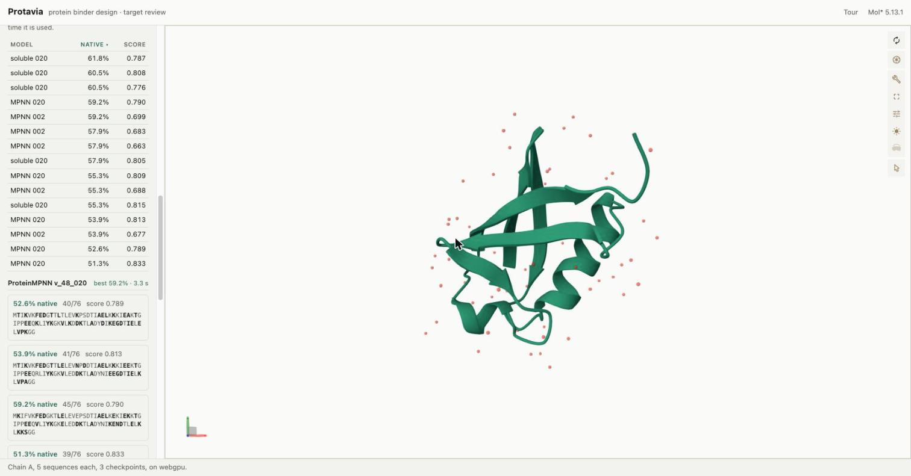
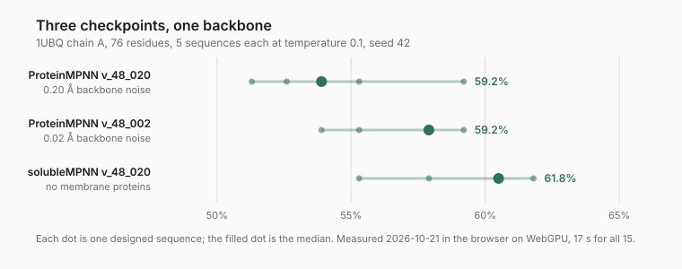

<h1 align="center">Protavia</h1>

<p align="center">
<b>Open a protein, redesign a chain of it, and compare what three models make of the same
backbone — in a browser tab, in about a second.</b><br>
One page. No install, no account, no server. Nothing you open leaves the machine.
</p>
<p align="center">


</p>

<p align="center">

</p>

## Open it

| Where | How |
|---|---|
| The web | **[protavia.naklitechie.com](https://protavia.naklitechie.com)** |
| Inside NakliOS | [naklios.dev](https://naklios.dev) → Think & Research → Protavia |
| This repository | `python3 -m http.server 8000`, then `http://localhost:8000/` |

Press **Ubiquitin** on the left, then **Redesign backbone**. Three sequences come back in about a
second, each scored against the real protein. A tour runs on the first visit and reopens from
**Tour** in the header. You can also search the Protein Data Bank by name, type a code like
`1ubq`, or drop in a file of your own. A dropped file is read in the page and never uploaded;
searching is the only thing here that touches the network.

## Why

You have a target structure and you want to know what a sequence model would put on it. The usual
answer is a Python environment, a CUDA build, a weights download and an afternoon — then another
afternoon to run the same backbone through a second checkpoint and see whether the answer is the
model or the fold.

Protavia is the part of that which does not need a cluster. It loads the structure, runs
ProteinMPNN on the GPU already in the machine through WebGPU, and puts the designs in one table
you can order. Each checkpoint is about 9 MB and loads the first time you use it.

It is not a binder design pipeline. The AlphaFold2 design loop needs gradients, which no browser
gives you; that stays on a real machine and the bridge to it is not built. What works today is the
target, the redesign, the comparison and the table.

## Results



**On ubiquitin, the checkpoint trained without membrane proteins recovers the native sequence most
often: a median of 60.5% against 53.9% for the default.** That ordering is what the training
predicts, which is the reason this is a bench and not a table of one number. Recovery is the
fraction of designed positions matching the real amino acid; the model sees only the backbone, so
agreement is evidence it reads the fold, not evidence the design is good.

Reproduce it: open the live site, press **Ubiquitin**, tick all three checkpoints, set sequences to
5, and press **Redesign backbone**. Raw numbers: [`marketing/bench-ubiquitin.json`](marketing/bench-ubiquitin.json);
the chart is drawn from them by `node scripts/results-chart.mjs`.

## Driving it from a script

Every button on the page is one entry in a manifest the page publishes, so anything that can run
JavaScript in the tab can do what a person can:

```js
await protavia.run('open-target', { id: '1ubq' });
await protavia.run('redesign', { chain: 'A', checkpoints: ['v_48_020', 'soluble_v_48_020'], count: 5 });
await protavia.run('rank', { column: 'score' });
protavia.commands();   // every command, its arguments, and which acts are the person's alone
```

Opening a file from the disk is declared person-only: a browser hands a page a file only after a
real click on a picker, so no script stands in for that.

## Commands

```sh
python3 -m http.server 8000      # serve the app; open http://localhost:8000/
node --test tests/*.test.mjs     # 63 tests: the arithmetic, the structure walk, the table, the manifest
node scripts/results-chart.mjs   # redraw the Results chart from the measured numbers
node scripts/mirror-manifest.mjs # refresh the NakliOS mirror's file list; exits 1 when stale
npx wrangler deploy              # deploy to protavia.naklitechie.com
```

## Verify it yourself

```sh
node --test tests/*.test.mjs
```

The tests cover what is arithmetic rather than a browser: the ipSAE interface score, recomputed
from the two formulas the method is defined by; the walk over a structure's atoms; sequence
recovery; the ranking table's columns, including its refusal to rank on a column declared as
display-only; and whether the NakliOS mirror's file list is current.

What a test cannot reach is checked by hand and recorded with its numbers in
[`docs/DESIGN.md`](docs/DESIGN.md): `1ubq` and `1brs` give 660 and 5,153 atoms, matching
`grep -c '^ATOM\|^HETATM'` on the deposited files; WebGPU and WebAssembly return
character-identical sequences for one seed; and the ipSAE arithmetic matched
[DunbrackLab/IPSAE](https://github.com/DunbrackLab/IPSAE) to the six decimal places it prints.

## Licence

Code: MIT ([`LICENSE`](LICENSE)). Mol*, the vendored structure viewer, is MIT. Vendored weights and
libraries carry their own licences, recorded with their hashes in
[`vendor/README.md`](vendor/README.md).

The engines Protavia will drive are separate programs: FreeBindCraft and BindCraft version 1 are
MIT, while BindCraft2 is source-available and restricts hosting it for other people, which is why
the bridge drives a machine the person running it installed the engine on themselves
([`docs/compute-licences.md`](docs/compute-licences.md)).

---

[Design notes](docs/DESIGN.md) · [Engine licences](docs/compute-licences.md) ·
[NakliOS listing](docs/naklios-listing.md) · [Agent notes](AGENTS.md)
